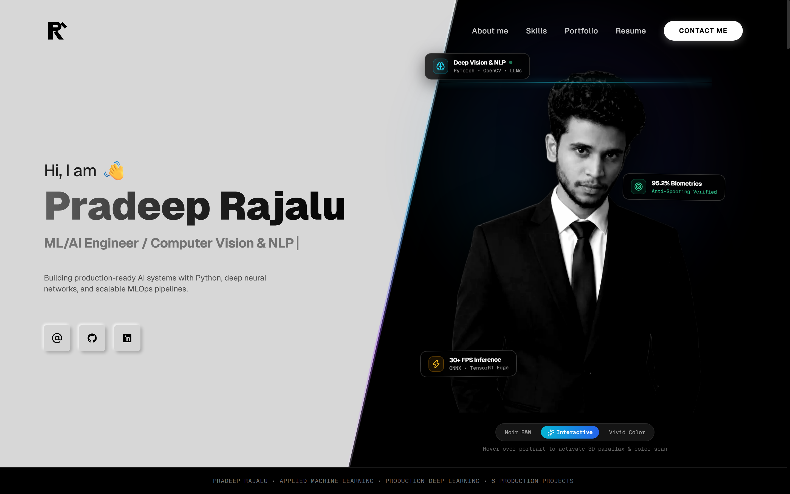

# Pradeep Rajalu — ML & AI Engineer Portfolio

A production-grade, responsive AI/ML engineer portfolio built with **Next.js 14**, **React 18**, **TypeScript**, and **Tailwind CSS**.



---

## 🌟 Key Features

1. **Applied ML Terminal Simulator (`Hero.tsx`)**:
   - Interactive pipeline simulator demonstrating real-time model inference.
   - Live tab switcher across:
     - **Face Biometrics (Computer Vision)**: MTCNN detection, landmark alignment, FaceNet 128-d cosine vector matching, optical liveness verification.
     - **NLP Abstract Synthesizer**: Transformer tokenization, LoRA rank=8 attention adapter injection, constrained beam search.
     - **MLOps Quality Check**: Great Expectations schema assertion suite, Isolation Forest outlier treatment, distribution drift test.
   - Interactive **Simulate Inference** execution button with live updated latency and confidence metrics.

2. **Quantified Impact Quick Stats (`QuickStats.tsx`)**:
   - 6+ End-to-End Production Architectures
   - 95.2% Peak Model Accuracy Benchmark (Biometric verification)
   - 40% Pipeline Efficiency Gain (Automated MLOps preprocessing)
   - 100% Documented Repositories on GitHub

3. **Filterable 6 ML Project Showcase (`ProjectsSection.tsx`, `ProjectCard.tsx`, `ProjectModal.tsx`)**:
   - Real-time search by keyword, model, or tech stack.
   - Category filtering: **All**, **Computer Vision**, **Natural Language Processing**, **Deep Learning**, **MLOps & Pipelines**, **Business Analytics**.
   - Interactive **Architecture & Deep Dive Modal**:
     - Engineering Challenge vs Architectural Solution
     - Step-by-Step Production Pipeline Sequence
     - Quantified Technical Benchmarks Table (Latency, Throughput, F1 Score, Memory Footprint)
     - **Live Interactive Sandbox**:
       - *Face Biometrics*: Cosine similarity threshold slider & live vector distance match.
       - *Emotion CNN*: Real-time confidence bar distributions across 7 facial expressions.
       - *Academic NLP*: Domain topic selector with instantaneous abstract synthesis.
       - *Churn Risk*: Interactive tenure/pricing sliders with live SHAP attribution breakdown.
       - *MLOps Pipeline*: 4-stage automated validation runner.

4. **Technical Competencies & Stack Grid (`SkillsSection.tsx`)**:
   - Categorized into Deep Learning & ML, Computer Vision & NLP, MLOps & Infrastructure, and Languages & BI.
   - Proficiency level badges (Advanced, Proficient).

5. **About & Engineering Standards (`About.tsx`)**:
   - Professional narrative emphasizing production-first mindset, rigorous evaluation, and inference optimization.
   - Direct contact chips: Email, Phone, Location (India), Availability status.

6. **Applied Experience & Education Timeline (`ExperienceSection.tsx`)**:
   - Detailed career milestones with quantifiable impact points.
   - Bachelor of Technology in Computer Science & Engineering (AI/ML Specialization) with Distinction.
   - Industry certifications (DeepLearning.AI, Computer Vision Guild).

7. **Validated Contact Section (`ContactSection.tsx`)**:
   - One-click copy email button & direct telephone links.
   - Validated message dispatch form (Name, Email, Subject, Message) with celebratory success state.

8. **Printable Resume / CV Modal (`ResumeModal.tsx`)**:
   - Accessible via the "Resume" button in the navbar or hero.
   - Printable (`window.print()`) curriculum vitae ready for recruiters.

9. **Dark / Light Mode**:
   - Sleek dark mode by default with instant toggle and `localStorage` persistence.

10. **SEO & Accessibility**:
    - Complete metadata tags, OpenGraph social sharing, and Schema.org `Person` JSON-LD structured data.

---

## 🛠️ Tech Stack

- **Framework**: Next.js 14.2 (App Router)
- **UI Library**: React 18, TypeScript
- **Styling**: Tailwind CSS (Dark Mode, Glassmorphism, CSS Grid patterns)
- **Icons**: Lucide React + Custom SVG Brand Icons
- **Data Architecture**: Structured TypeScript models (`src/data/projects.ts`, `src/data/profile.ts`)

---

## 🚀 Getting Started

### 1. Run Locally
```bash
# Install dependencies
npm install

# Start development server
npm run dev
```
Open [http://localhost:3000](http://localhost:3000) in your browser.

### 2. Production Build
```bash
# Build optimized production bundle
npm run build

# Start production server
npm run start
```

### 3. Deploy to Vercel
1. Push this repository to GitHub:
   ```bash
   git init
   git add .
   git commit -m "feat: initial release of ML/AI engineer portfolio"
   git branch -M main
   git remote add origin https://github.com/raju25/portfolio.git
   git push -u origin main
   ```
2. Import the project into [Vercel](https://vercel.com/new).
3. Vercel automatically detects Next.js and deploys your site in under 60 seconds.

---

## 👤 Portfolio Owner

- **Name**: Pradeep Rajalu
- **Role**: Machine Learning & Applied AI Engineer
- **Email**: [pradeeprajalu5@gmail.com](mailto:pradeeprajalu5@gmail.com)
- **Phone**: [+91-7010-327639](tel:+917010327639)
- **Location**: India
- **LinkedIn**: [linkedin.com/in/raju25](https://linkedin.com/in/raju25)
- **GitHub**: [github.com/raju25](https://github.com/raju25)
